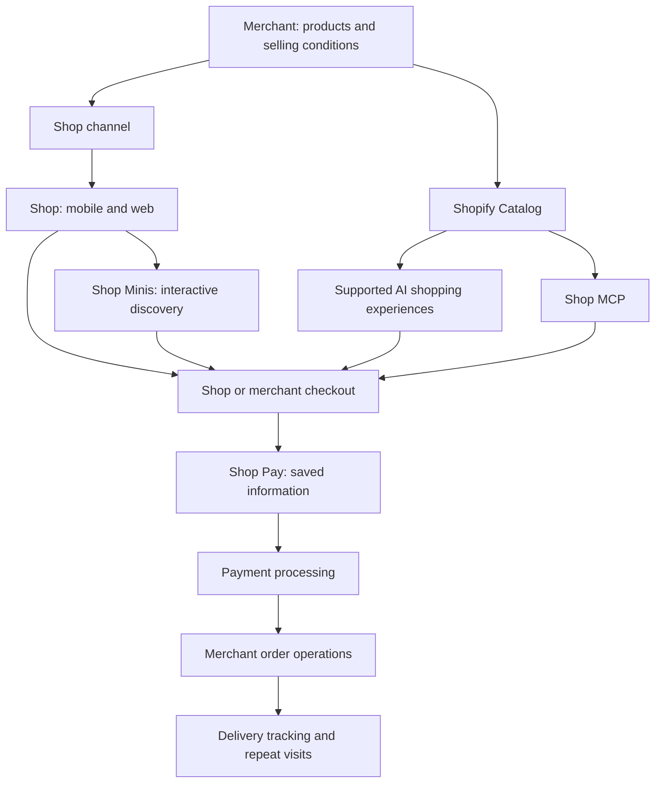
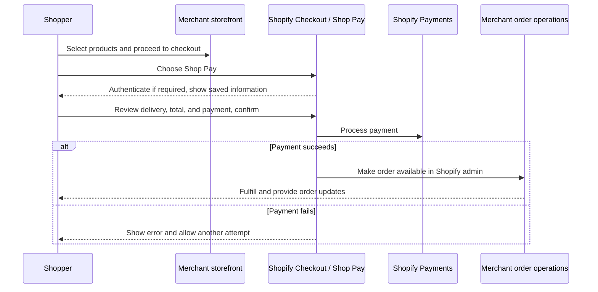
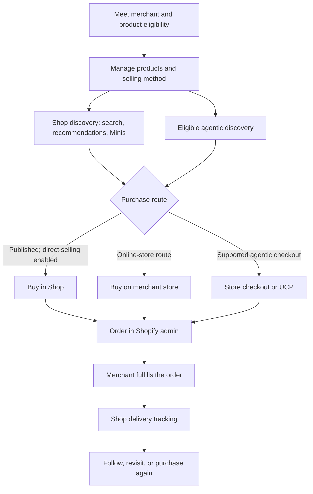
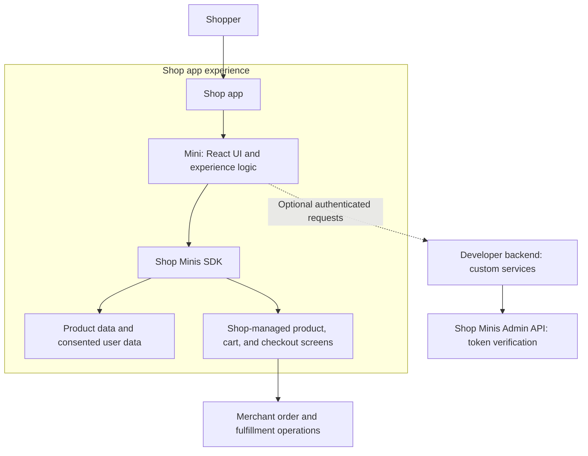
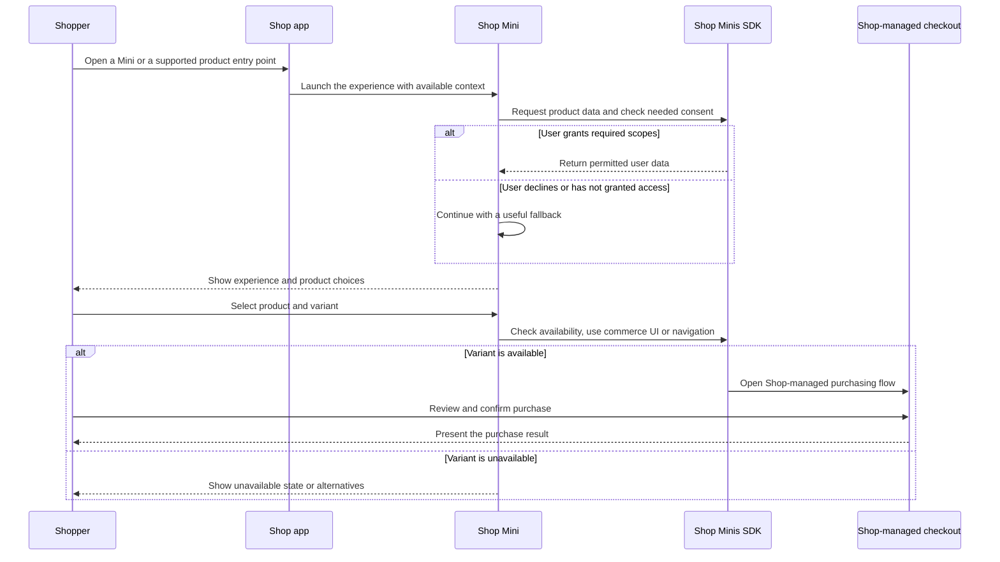
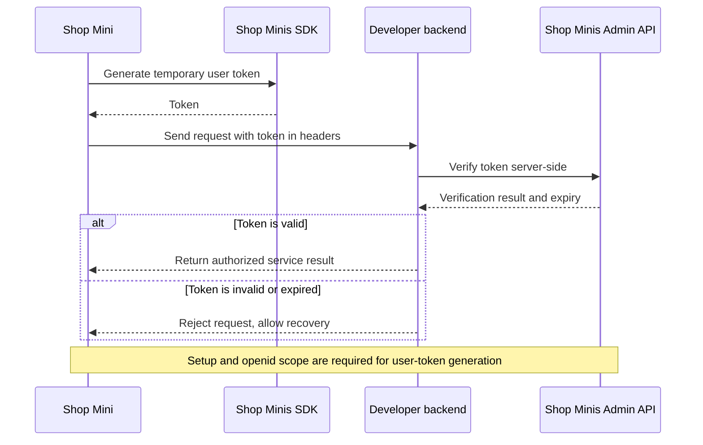
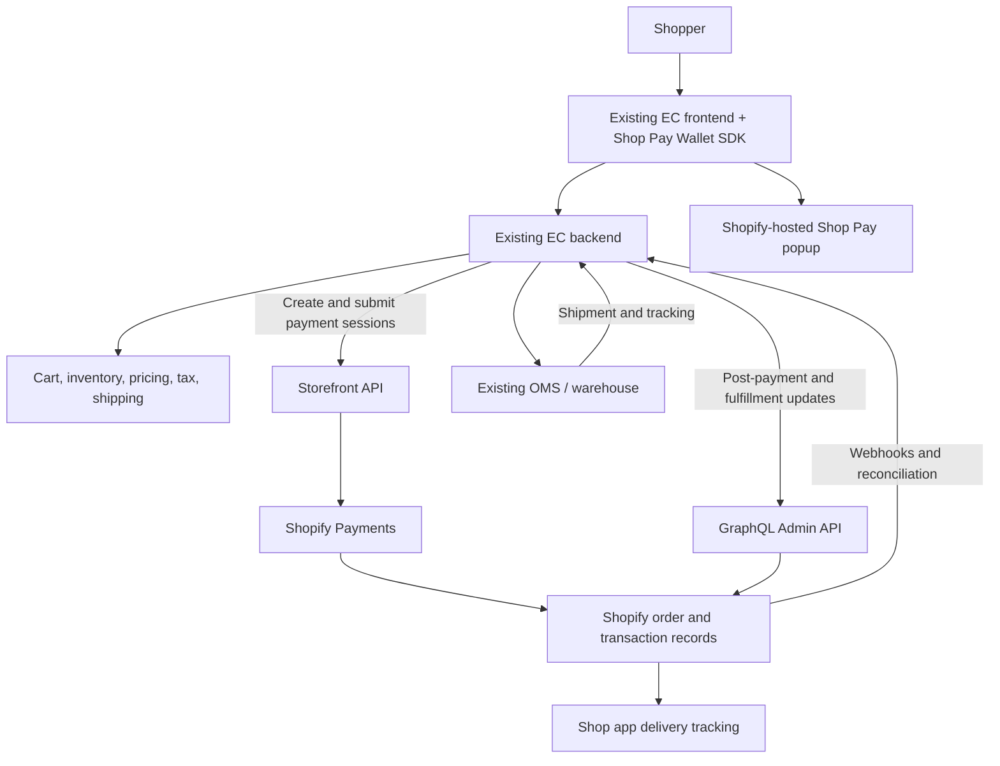
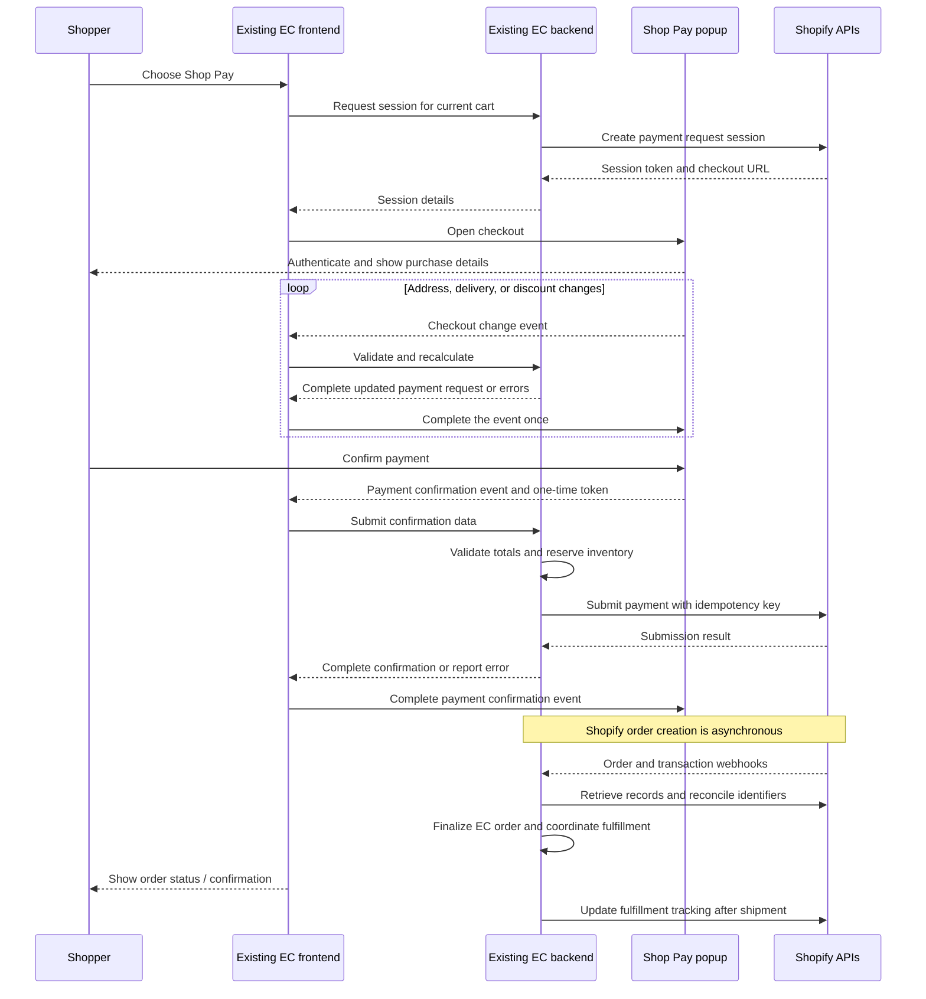
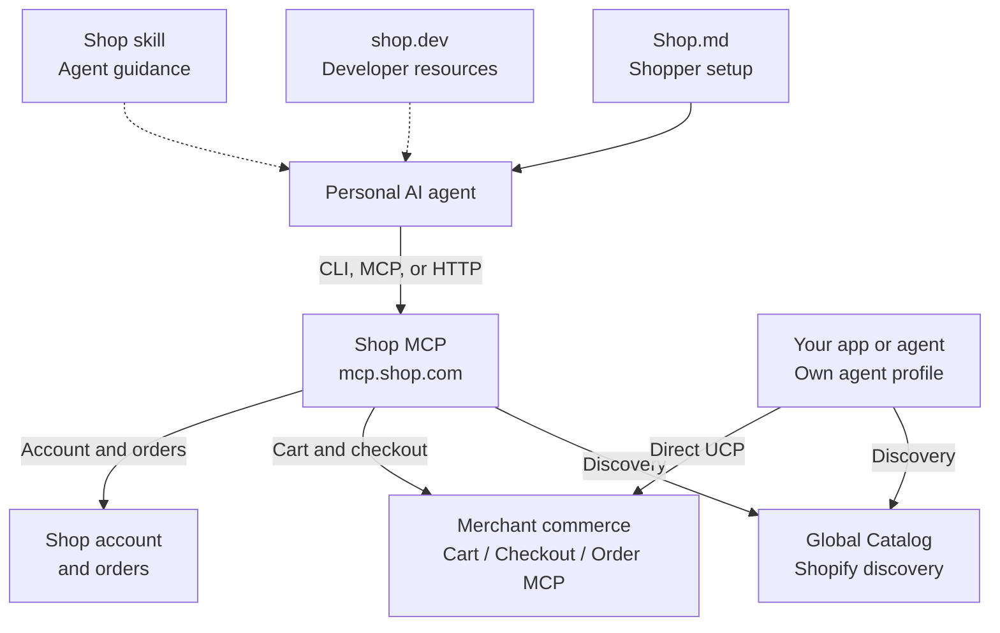
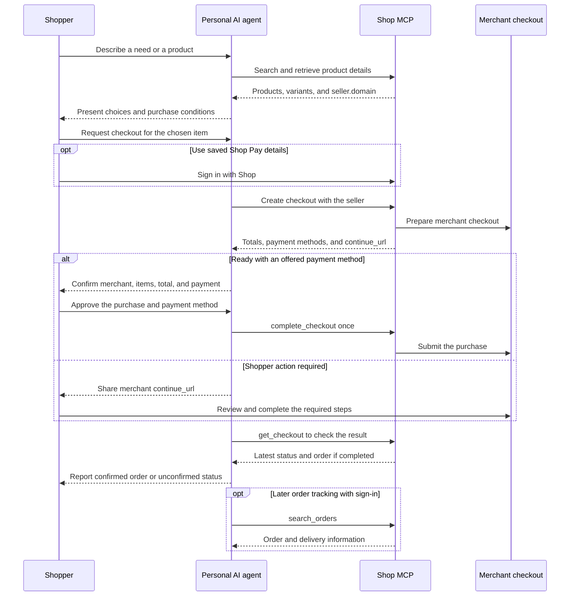

# Shop: reach the world and the AI shopping era

Connect product discovery, faster checkout, and repeat purchases through Shop. Explore cross-border sales, subscriptions, and agentic shopping as opportunities to grow beyond an existing marketplace mix.

Public documentation reviewed: **October 15, 2026**; Shop MCP, Shop.md, shop.dev, and Catalog comparison updated **October 19, 2026**. Diagrams describe documented interfaces and merchant-visible workflows; they do not describe Shopify internal implementation.

## 1. Why Shop matters

Shop adds a sales channel to a merchant’s own commerce business: customers can discover a brand, buy, follow it, and return. The business opportunity is to reach customers beyond existing acquisition channels while maintaining the merchant’s customer relationship.

**No additional listing or marketplace fees.** Shop does not charge marketplace fees. Shopify plan charges, payment processing, paid campaigns, shipping, and applicable app or integration costs remain separate. “Free to list” does not mean every cost of selling is zero. [Source: Sell on Shop](https://www.shopify.com/shop).

### Evaluate growth through customer needs

The migration proposal should connect platform investment to future sales opportunities. Review each marketplace’s contribution profit, advertising spend, integration cost, and operating effort. Then evaluate Shop alongside the channels that already reach valuable customers. Keep the fulfillment and OMS integrations needed for the chosen channel mix.

| Opportunity | Merchant action | What to measure |
| --- | --- | --- |
| New customers | Publish eligible products and improve product information | New-to-brand customers and contribution profit |
| Cross-border demand | Choose a destination market and configure delivery and selling conditions | Overseas orders, delivery cost, and returns |
| Easier purchasing | Offer Shop Pay and review the checkout experience | Checkout completion by device and payment method |
| Recurring purchases | Offer suitable subscription products | Subscription orders and retention |
| AI discovery | Describe use cases, materials, fit, and other decision criteria | Discovery-to-purchase progress and resulting orders |

Treat sales growth as a hypothesis to measure. Start with one market and product group, compare results with a baseline, and expand when the economics and customer experience support it. Shop can diversify acquisition; it does not guarantee sales or replace every marketplace or OMS.

## 2. Shop ecosystem overview

| Product or surface | Role |
| --- | --- |
| Shop | Shopping destination on mobile, web, and supported agentic experiences; also supports delivery tracking |
| Shop channel | Merchant controls for the Shop Store, eligible products, direct selling, and performance |
| Shop Pay | Accelerated checkout using information that a shopper has saved |
| Shopify Payments | Payment processing and payouts; distinct from the Shop shopping destination |
| Shop Minis | Interactive shopping experiences inside the Shop app, built with a React SDK |
| Shop Pay Wallet | Integration that adds Shop Pay to an existing non-Shopify checkout |
| Shop.md | Shopper entry point for setting up a personal AI shopping agent |
| Shop MCP | Hosted tools for product discovery, carts, checkout, Shop accounts, and order tracking |
| shop.dev | Developer portal with a playground, connection guides, and API references |
| Shopify Catalog / UCP | Product discovery data and a commerce protocol used by supported agentic experiences |

This is a capability map, not a deployment diagram. Product eligibility, buyer location, and the integration determine the actual discovery and checkout route. Shop Minis run in the Shop app; Shop.md connects external agents. [Sources: Shop overview](https://help.shopify.com/en/manual/online-sales-channels/shop), [Shop developer platform](https://shopify.dev/docs/api/shop).

## 3. Shop Pay in Checkout

Shop Pay reduces repeated entry of shipping, billing, and payment information for shoppers who have saved it. It is a checkout option on a merchant’s store and in Shop. On Shopify, Shop Pay is included with Shopify Payments and transactions use the applicable Shopify Payments rates. [Sources: Shopify Checkout](https://www.shopify.com/checkout), [Shop Pay](https://help.shopify.com/en/manual/payments/shop-pay).

The sequence summarizes the customer journey. Measure checkout completion in the merchant’s actual setup rather than turning a published maximum conversion uplift into a sales forecast. Subscription purchases require a supported subscription app and payment setup. [Source: Subscription considerations](https://help.shopify.com/en/manual/products/purchase-options/subscriptions/considerations).

## 4. Shop channel and Agentic Commerce

Shop connects discovery with purchasing and post-purchase visits. Eligible products can be discovered in Shop and supported AI experiences. A product published to Shop with direct selling enabled can be purchased there; a discoverable product that is not published to Shop can direct the shopper to the merchant’s online store. [Source: Shop products and collections](https://help.shopify.com/en/manual/online-sales-channels/shop/manage-shop-store/products-and-collections).

| Shop menu | What it manages | Key capabilities and integrations | Official help |
| --- | --- | --- | --- |
| Posts | Shoppable image and video content shown in the Shop home feed, Shop Store, and Following tab | Create, schedule, expire, and tag posts with up to 10 products or one collection. Reuse media made for social networks or other channels; import recent and new Instagram Reels, images, and carousels; or create and sync shoppable video with supported partner apps in the Shopify App Store's Shop shoppable video collection. | [Create posts for Shop](https://help.shopify.com/en/manual/online-sales-channels/shop/marketing/posts) |
| Advertising | Performance-based customer acquisition through Shop Campaigns | Set average customer acquisition cost, target countries, target order value, daily budget, and optional customer segments. Ads can run in Shop, on the Shop website, in Shopify Product Network, and optionally on third-party platforms. | [Shop Campaigns](https://help.shopify.com/en/manual/online-sales-channels/shop/shop-campaigns) |
| Reviews | Product review collection and merchant review management | View, reply to, and report reviews; set the request delay from 1 to 180 days after delivery; include eligible online-store purchases; automate with Shopify Flow; and display eligible reviews collected by supported partner apps. | [Shop product reviews](https://help.shopify.com/en/manual/online-sales-channels/shop/product-reviews) / [Manage reviews](https://help.shopify.com/en/manual/online-sales-channels/shop/product-reviews/manage) |
| Promise | Shop Promise eligibility, delivery-date display, and the limited guarantee | Eligible high-performing merchants fulfilling from the United States can enable or disable the badge and predicted delivery dates, manage the shipping-rate description, and provide the limited guarantee for eligible late first deliveries. | [Activate Shop Promise](https://help.shopify.com/en/manual/fulfillment/setup/shop-promise/activate) |
| Settings | Shop selling, discovery, and channel preferences | Choose direct selling or an online-store link; manage estimated delivery dates, in-store self-serve returns, subscriptions, review behavior, storefront-activity reminders, search-engine indexing, and participation in Shop marketing campaigns. | [Set up the Shop channel](https://help.shopify.com/en/manual/online-sales-channels/shop/setup) / [Marketing settings](https://help.shopify.com/en/manual/online-sales-channels/shop/marketing/settings) |

Demo videos for these menu items will be added later.

### Cross-border and AI availability

For cross-border sales, choose destination markets and configure product availability, pricing, shipping, and customer support. Shop search reflects the shopper’s location and only includes stores that ship there. Markets and delivery setup support this work; listing a product does not make it sellable everywhere. [Sources: Shop customer experience](https://help.shopify.com/en/manual/online-sales-channels/shop/customer-experience), [Shopify Markets](https://help.shopify.com/en/manual/markets).

**Conversational search in Shop is currently available to shoppers in the United States and Canada.** Other countries have keyword search. External agentic experiences have their own availability and checkout routes. Japanese support for Shop does not imply that every AI feature is available in Japan. [Source: Shop search and agentic experiences](https://help.shopify.com/en/manual/online-sales-channels/shop/customer-experience).

### Subscriptions in Shop

Shop supports subscription purchases through Shopify Subscriptions and third-party subscription apps. Enable subscriptions in the Shop channel settings. Customers manage purchased subscriptions through their customer account on the online store. If subscriptions are disabled for Shop, Shop directs shoppers to the online store to purchase them. [Source: Sell subscription products in Shop](https://help.shopify.com/en/manual/online-sales-channels/shop/manage-shop-store/products-and-collections).

## 5. Shop Minis

Shop Minis are full-screen shopping experiences inside the Shop app. Quizzes, shoppable videos, virtual try-ons, and curated recommendations can help a shopper choose a product. Developers use the Shop Minis React SDK; customers enter from Minis discovery or supported product-page entry points. [Sources: Shop Minis for shoppers](https://help.shop.app/en/shop/shopping/discover/shop-minis), [React SDK](https://shopify.dev/docs/api/shop-minis).

### Architecture and system boundaries

Use SDK components and navigation for Shop-managed commerce screens. A Mini can add product-selection logic or a custom service without implementing its own payment collection. The optional backend is an integration choice, not a requirement for every Mini. [Sources: Shop navigation](https://shopify.dev/docs/api/shop-minis/hooks/navigation/useshopnavigation), [Custom backend](https://shopify.dev/docs/api/shop-minis/custom-backend).

### Discovery-to-purchase flow

Scope consent is optional: keep the core experience usable if a shopper declines. Shop Minis user scopes control access to the shopper’s data and are different from merchant-granted app access scopes. Check product availability before enabling purchase actions. [Sources: Scopes consent](https://shopify.dev/docs/api/shop-minis/scopes-consent), [SDK availability and intent updates](https://shopify.dev/changelog/posts/shop-minis-march-april-2026-update).

### Optional backend authentication

Generate the temporary token with `useGenerateUserToken` and verify it with `userTokenVerify` on the backend. Keep server credentials on the backend and expire cached verification results according to the token expiry. Declare external services in the reviewed `trusted_domains` list. Only request the scopes the experience needs. [Sources: Custom backend](https://shopify.dev/docs/api/shop-minis/custom-backend), [Network requests](https://shopify.dev/docs/api/shop-minis/network-requests).

## 6. Shop Pay off Shopify

Shop Pay Wallet adds Shop Pay to an existing commerce platform without migrating its storefront. It requires Shopify Payments eligibility, a supported business location, and frontend/backend API integration. Create a new Shopify store for this integration; the Wallet API cannot be used on an existing Shopify store. [Sources: Shop Pay on any platform](https://help.shopify.com/en/manual/payments/shop-pay/shop-pay-on-any-platform), [Wallet setup](https://shopify.dev/docs/api/commerce-components/pay).

### Architecture and ownership

| Responsibility | Owner in this integration |
| --- | --- |
| Cart, prices, discounts, tax, shipping, and inventory | Existing EC backend |
| Shopper authentication, saved addresses, and payment details | Shopify / Shop Pay |
| Payment processing and Shopify payment/order records | Shopify |
| EC order record, OMS coordination, and customer order emails | Existing EC and merchant operations |
| Shipment tracking | Merchant updates Shopify fulfillment records; Shop displays tracking |
| Captures, refunds, cancellations, and disputes | Merchant operations coordinate with Shopify APIs and payment records |

Both systems hold order records for different purposes. Link identifiers and reconcile them; a browser success event alone is insufficient. Existing checkout add-ons such as rewards or engraving should be selected before entering Shop Pay. The merchant’s system sends order emails for Wallet orders. [Sources: System responsibilities](https://shopify.dev/docs/api/commerce-components/pay), [Wallet troubleshooting](https://shopify.dev/docs/api/commerce-components/pay/troubleshooting-guide).

### Payment and order reconciliation flow

Create sessions with `ShopPayPaymentRequestSessionCreate` and submit them with `ShopPayPaymentRequestSessionSubmit`. Frontend change events are handled by the existing backend, which returns a complete updated request. Authentication stays between the shopper and Shopify. These API names identify the documented integration points; the diagram is not executable code. [Sources: GraphQL pre-payment](https://shopify.dev/docs/api/commerce-components/pay/graphql-pre-payment), [Sessions and events](https://shopify.dev/docs/api/commerce-components/pay/sessions-and-events).

### Failure and recovery paths

- **Invalid amount or unavailable inventory:** return an error before payment submission and refresh the checkout state.
- **Declined payment:** present the failure and permit another payment attempt; do not treat the order as paid.
- **Timeout or ambiguous submission result:** retain the attempt identifiers and use the same idempotency key for the same payment attempt; reconcile before retrying as a new charge.
- **Closed popup or missing webhook:** recover order and transaction state with a reconciliation job rather than relying on the browser.
- **Refund or cancellation:** coordinate the EC record, inventory/OMS, and Shopify payment actions. Sending an EC cancellation alone does not reconcile every system.

The recovery paths are integration design recommendations based on the public Wallet guides. Establish ownership for reconciliation, fulfillment, refunds, and disputes. [Sources: Monitoring and resiliency](https://shopify.dev/docs/api/commerce-components/pay/monitoring), [GraphQL post-payment](https://shopify.dev/docs/api/commerce-components/pay/graphql-post-payment).

## 7. Shop MCP, Shop.md, and shop.dev

Shop connects personal AI agents to shopping as well as serving shoppers in its own app. Three public surfaces help different audiences get started. [Sources: Shop.md](https://shop.md/), [Shop MCP overview](https://shop.dev/docs), [shop.dev developer portal](https://shop.dev/).

### Understand the three roles

| Surface | Audience and role | Start here |
| --- | --- | --- |
| Shop.md | Shoppers setting up a personal AI shopper | Copy a setup prompt, use the ChatGPT or Claude directory links, or follow “Build your own skill” |
| Shop MCP | Developers and compatible agents calling shopping tools | Connect to `https://mcp.shop.com/` for discovery, carts, checkout, account access, and orders |
| shop.dev | Developers building a shopping app or agent | Explore the playground, quickstart, connection guides, and tool/API references |

Shop.md guides setup; the connected agent uses Shop’s tools to perform the shopping. It is also separate from this repository’s Markdown source. The public [Shop setup skill](https://shop.com/skill.md) selects the first available connection in CLI, MCP, then HTTP order. Use one connection method with its matching skill. MCP guidance is published as [Shop MCP skill](https://mcp.shop.com/skill.md) and the resource `skill://shop/SKILL.md`. These files describe agent behavior; they are not shopper accounts or payment authorization. [Source: Connect an agent](https://shop.dev/docs/connect).

### What Shop MCP provides

The public tool reference lists **17 tools**, grouped below. The CLI, compatible MCP clients, and direct HTTP calls reach the same service; an ordinary app can use the tools without a language model. [Sources: Shop MCP overview](https://shop.dev/docs), [Tool reference](https://shop.dev/docs/tools).

| Tool group | Capability | Shop sign-in |
| --- | --- | --- |
| Catalog: 3 tools | `search_catalog`, `lookup_catalog`, and `get_product` for discovery and product/variant details | Optional; signed-in results can reflect saved preferences |
| Cart and checkout: 7 tools | Create, read, and update a cart or checkout; submit a supported purchase | Optional for tool access; saved addresses and Shop Pay use the shopper’s account |
| Account and orders: 2 tools | `get_account` and `search_orders` for account details and active/recent orders | Required |
| Purchase approvals: 5 tools | Request and manage approval for an agent paying at a non-Shopify checkout | Required; client permissions also apply |

Use the root endpoint exactly as documented, without appending `/mcp`. MCP clients must support protocol version `2026-07-28`; older clients limited to the `initialize` handshake need the CLI or HTTP route instead. Follow the [connection guide](https://shop.dev/docs/connect) for the current requirements.

### How Shop MCP relates to Global Catalog

Shop MCP’s discovery tools call Shopify’s Global Catalog. An application can also call Global Catalog directly when it needs product discovery while managing the rest of the experience itself. The arrows below show documented responsibilities, not Shopify’s internal deployment. [Source: Catalog API comparison](https://shop.dev/docs/catalog-api).

| Decision | Shop MCP | Direct Global Catalog MCP |
| --- | --- | --- |
| Endpoint | `https://mcp.shop.com/` | `https://catalog.shopify.com/api/ucp/mcp` |
| Tool coverage | Discovery plus shopping and Shop account tools | Three discovery tools: search, lookup, and product details |
| Agent profile for Catalog calls | Shop MCP supplies its own | Publish and send your own profile on each call |
| Credentials | Shopper’s Shop token for account features; search can be anonymous | API credentials identify the application; search can be keyless at lower limits |
| Best fit | Connect a personal shopper through purchase and tracking | Add discovery to your own app and control the surrounding integration |

The three discovery tools accept the same `catalog` arguments. For direct Catalog requests, send the public profile URL in `meta.ucp-agent.profile`; missing profiles are rejected with HTTP 422. Shop MCP supplies its own profile, so do not copy that Catalog metadata into its search arguments. [Source: Catalog API](https://shop.dev/docs/catalog-api).

An agent profile declares capabilities; it does not sign in a shopper. An API key and its access token identify the developer’s application and enable higher Catalog limits. A Shop account token represents the shopper. Direct UCP integrations can separately use buyer-linked tokens where supported. These credentials serve different purposes. [Sources: Shop authentication](https://shop.dev/docs/authentication), [UCP authentication and rate limiting](https://shopify.dev/docs/agents/profiles/auth-and-rate-limiting).

Choose **Saved Catalogs** when a direct Global Catalog integration repeatedly needs the same store or category filters; save the configuration in Dev Dashboard. For an agent serving only one merchant, evaluate **Storefront Catalog** at `https://{storeDomain}/api/ucp/mcp`. Global Catalog itself performs discovery. To add purchasing or order access directly, integrate the merchant’s Cart, Checkout, and Order MCP capabilities with the required profile, credentials, and permissions. A Catalog API key alone does not grant purchase-completion permission. [Sources: Catalog interfaces and Saved Catalogs](https://shopify.dev/docs/agents/catalog), [UCP authentication](https://shopify.dev/docs/agents/profiles/auth-and-rate-limiting), [Checkout MCP](https://shopify.dev/docs/agents/carts-and-checkout/checkout-mcp).

### From discovery to a confirmed purchase

Each checkout belongs to one merchant. Share its `continue_url` so the shopper can review and pay; use it when the checkout requires escalation or offers no usable payment method. Only `status: completed` with an `order` confirms a purchase. If completion times out or is ambiguous, read `get_checkout`; do not submit `complete_checkout` again or create a replacement purchase. [Source: Carts and checkout](https://shop.dev/docs/checkout).

This sequence describes a Shopify-store route. At the October 13, 2026 launch, Shop MCP has no webhooks, so checkout status is polled. Existing direct Catalog integrations continue to work without changes. [Source: Shop MCP launch](https://shopify.dev/changelog/posts/add-shopping-and-shop-pay-checkout-to-any-agent-with-shop-mcp).

For a non-Shopify checkout, the separate approval flow lets the shopper review the store, terms, saved card, and spending limit in Shop before the agent receives purchase-specific payment credentials. It depends on client permissions and is not a fallback for a failed Shopify checkout. This agent approval route is distinct from the merchant-built **Shop Pay Wallet** integration described in section 6. [Source: Approvals outside Shopify](https://shop.dev/docs/approvals).

## 8. Getting started and measuring results

1. **Check eligibility.** Review the current Shop merchant and product requirements, Shopify Payments setup, and Shopify Network Intelligence setting. Confirm Shop channel status in the admin.
2. **Prepare products.** Provide accurate titles, images, categories, prices, descriptions, and availability. Explain the product details that help both people and AI choose.
3. **Choose the purchase route.** Configure direct selling or the online-store route and enable subscriptions where needed.
4. **Choose a cross-border market.** Align product availability, prices, delivery, returns, and support with the destination.
5. **Review checkout and operations.** Validate the buyer journey and order/fulfillment handoff. For Wallet or Minis development, use the relevant SDK and API guides.
6. **Measure the outcome.** Compare new customers, overseas orders, checkout completion, retention, contribution profit, and operating effort with a baseline.

Eligibility includes an active Starter plan or higher, Shopify Payments, applicable merchant/product requirements, and a non-private online store. The full current criteria and approval status govern availability. Shop channel controls, Shop discovery, and Catalog eligibility are related but distinct. [Sources: Shop requirements](https://help.shopify.com/en/manual/online-sales-channels/shop/eligibility/requirements), [Shop overview and Network Intelligence](https://help.shopify.com/en/manual/online-sales-channels/shop), [Catalog requirements](https://help.shopify.com/en/manual/shopify-catalog/requirements).

## 9. Frequently asked questions

### Can customers buy subscriptions in Shop?

Yes. Shop integrates with Shopify Subscriptions and third-party subscription apps. Enable subscriptions in the Shop channel. Customers manage the subscription through their online-store customer account; subscription app and payment conditions still apply. [Source: Subscriptions in Shop](https://help.shopify.com/en/manual/online-sales-channels/shop/manage-shop-store/products-and-collections).

### Is Shop available in Japanese?

Yes. Shop supports Japanese and multiple other languages. Customers can use a Japanese interface. Separately review your product descriptions, customer support, and localized selling conditions. Language support does not make every regional feature available. [Source: Supported Shop languages](https://help.shopify.com/en/manual/online-sales-channels/shop).

### Is listing on Shop free?

Shop has no additional listing or marketplace fees. Shopify plan and payment charges, shipping, paid acquisition, and any app or integration costs are separate. [Source: Shop pricing statement](https://www.shopify.com/shop).

### Can a Japanese merchant sell internationally through Shop?

Eligible merchants can reach shoppers in supported destination markets when the products and delivery setup allow it. Configure the market and shipping destination first. Search only includes stores that deliver to the shopper’s location. [Sources: Shop customer experience](https://help.shopify.com/en/manual/online-sales-channels/shop/customer-experience), [Markets](https://help.shopify.com/en/manual/markets).

### Is Shop conversational search available in Japan?

Shop conversational search is currently available to shoppers in the United States and Canada. Japan has the standard keyword search experience. Shop.md and other external AI integrations have separate supported flows and availability. [Source: Shop search](https://help.shopify.com/en/manual/online-sales-channels/shop/customer-experience).

### Can I use Shop Pay without migrating my EC platform?

Yes, through the Shop Pay Wallet integration if your business meets the requirements. It needs a dedicated new Shopify store, Shopify Payments setup, and frontend/backend development. Your EC continues to manage its commerce data and operations. Do not assume this integration automatically enables every Shop feature or subscription configuration. [Source: Shop Pay on any platform](https://help.shopify.com/en/manual/payments/shop-pay/shop-pay-on-any-platform).

### How are Shop, Shop Pay, and Shopify Payments different?

Shop is the shopping and post-purchase destination. Shop Pay is the accelerated checkout experience. Shopify Payments processes payments and handles payouts. These roles work together but should be explained separately. [Sources: Shop](https://help.shopify.com/en/manual/online-sales-channels/shop), [Shop Pay](https://help.shopify.com/en/manual/payments/shop-pay).

### Can I choose whether my products appear in Shop Minis?

Shop determines relevant products for Minis. Merchants cannot choose which products appear in a Mini or opt out specifically from Minis. Overall product publication and eligibility remain relevant. [Source: Shop Minis in the customer experience](https://help.shopify.com/en/manual/online-sales-channels/shop/customer-experience).

### How are Shop MCP, Shop.md, and shop.dev different?

Shop.md helps shoppers set up an agent, Shop MCP supplies the shopping tools, and shop.dev provides developer guides and a playground. Start with Shop.md to use a personal shopper or shop.dev to build an integration. [Sources: Shop.md](https://shop.md/), [shop.dev](https://shop.dev/).

### Do I need an API key or a Shop sign-in to search?

Shop MCP search works without either. Sign in to use saved Shop details, personalized results, and order/account tools. For direct Global Catalog calls, send an agent profile even without a key; developer API credentials enable higher limits. They do not sign in a shopper. [Sources: Shop authentication](https://shop.dev/docs/authentication), [Catalog API](https://shop.dev/docs/catalog-api).

### Can Global Catalog alone complete a purchase?

No. Its three tools discover products and retrieve details. Add Shop MCP or integrate the merchant’s Cart, Checkout, and Order MCP capabilities. Direct `complete_checkout` requires a token permitted to complete purchases, a ready checkout, payment credentials, and buyer approval. [Sources: Catalog interfaces](https://shopify.dev/docs/agents/catalog), [UCP authorization](https://shopify.dev/docs/agents/profiles/auth-and-rate-limiting), [Checkout MCP](https://shopify.dev/docs/agents/carts-and-checkout/checkout-mcp).

### Must an existing Catalog integration migrate to Shop MCP?

No migration is required. Existing direct Catalog integrations continue working. Add Shop MCP when its Shop account and purchase flow fit your experience. [Source: Shop MCP launch](https://shopify.dev/changelog/posts/add-shopping-and-shop-pay-checkout-to-any-agent-with-shop-mcp).

### Which Catalog option fits one store or a fixed product selection?

Use Storefront Catalog for one merchant. For repeated cross-merchant store/category filters, evaluate a Saved Catalog configuration in Dev Dashboard. Both choices concern discovery; checkout and order handling remain separate capabilities. [Source: Catalogs and Saved Catalogs](https://shopify.dev/docs/agents/catalog).

### Does connecting Shop MCP let an agent buy without confirmation?

No. A connection or sign-in is not purchase approval. For a Shopify checkout, the shopper reviews the merchant, items, quantities, total, and offered payment method before completion. Non-Shopify approvals use a separate Shop review of the purchase, saved card, and limit, subject to client permissions. [Sources: Checkout confirmation](https://shop.dev/docs/checkout), [Purchase approvals](https://shop.dev/docs/approvals).

### Why might an MCP client fail to connect?

Use `https://mcp.shop.com/`, without `/mcp`, and check support for MCP `2026-07-28` and `server/discover`. Older `initialize`-only clients need the CLI or HTTP route. Load the skill that matches the chosen connection method. [Source: Connect an agent](https://shop.dev/docs/connect).

## 10. References

- [Shopify Checkout](https://www.shopify.com/checkout)
- [Sell on Shop](https://www.shopify.com/shop)
- [Shop overview and languages](https://help.shopify.com/en/manual/online-sales-channels/shop)
- [Shop customer experience](https://help.shopify.com/en/manual/online-sales-channels/shop/customer-experience)
- [Shop product management and subscriptions](https://help.shopify.com/en/manual/online-sales-channels/shop/manage-shop-store/products-and-collections)
- [Shop merchant requirements](https://help.shopify.com/en/manual/online-sales-channels/shop/eligibility/requirements)
- [Shop posts](https://help.shopify.com/en/manual/online-sales-channels/shop/marketing/posts)
- [Shop Campaigns](https://help.shopify.com/en/manual/online-sales-channels/shop/shop-campaigns)
- [Shop product reviews](https://help.shopify.com/en/manual/online-sales-channels/shop/product-reviews)
- [Shop Promise](https://help.shopify.com/en/manual/fulfillment/setup/shop-promise/activate)
- [Shop channel setup](https://help.shopify.com/en/manual/online-sales-channels/shop/setup)
- [Shop marketing settings](https://help.shopify.com/en/manual/online-sales-channels/shop/marketing/settings)
- [Shop Minis shopper guide](https://help.shop.app/en/shop/shopping/discover/shop-minis)
- [Shop Minis SDK](https://shopify.dev/docs/api/shop-minis)
- [Shop Pay on any platform](https://help.shopify.com/en/manual/payments/shop-pay/shop-pay-on-any-platform)
- [Shop Pay Wallet integration](https://shopify.dev/docs/api/commerce-components/pay)
- [Shop.md](https://shop.md/)
- [Shop MCP launch](https://shopify.dev/changelog/posts/add-shopping-and-shop-pay-checkout-to-any-agent-with-shop-mcp)
- [shop.dev developer portal and playground](https://shop.dev/)
- [Shop MCP overview](https://shop.dev/docs)
- [Connect an agent and load the skill](https://shop.dev/docs/connect)
- [Shop setup skill](https://shop.com/skill.md)
- [Shop MCP skill](https://mcp.shop.com/skill.md)
- [Shop MCP tool reference](https://shop.dev/docs/tools)
- [Shop MCP authentication](https://shop.dev/docs/authentication)
- [Shop MCP carts and checkout](https://shop.dev/docs/checkout)
- [Purchase approvals outside Shopify](https://shop.dev/docs/approvals)
- [Catalog API and Shop MCP comparison](https://shop.dev/docs/catalog-api)
- [Catalog interfaces and Saved Catalogs](https://shopify.dev/docs/agents/catalog)
- [UCP authentication and rate limiting](https://shopify.dev/docs/agents/profiles/auth-and-rate-limiting)
- [Checkout MCP](https://shopify.dev/docs/agents/carts-and-checkout/checkout-mcp)

## Disclaimer

This page is not official Shopify documentation. The maintainers do not accept responsibility for the accuracy, completeness, or consequences of using this content. Use it at your own discretion as supplemental material for understanding Shopify concepts and workflows. Content may change without notice.
